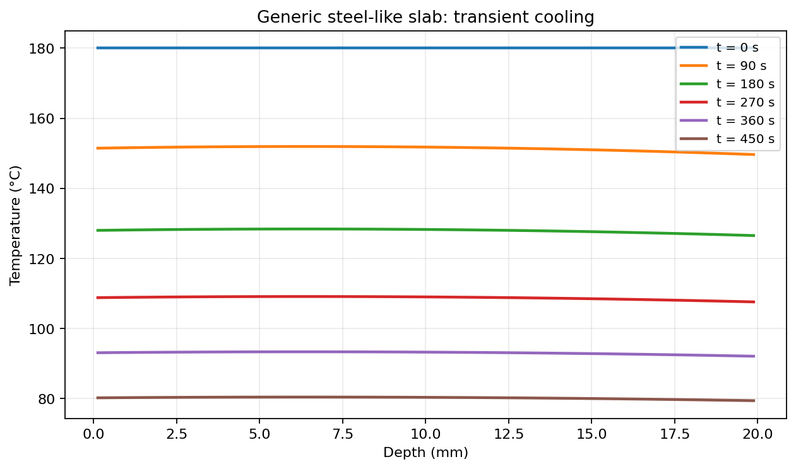
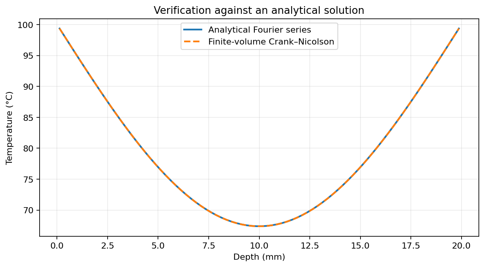
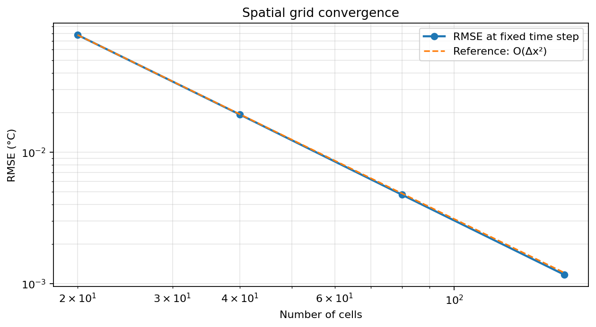
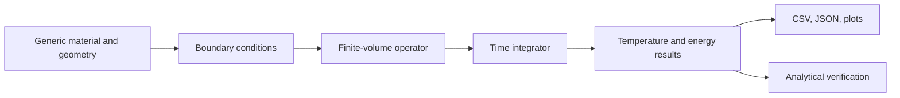

<div align="center">

# ThermalPhysics Workbench

### An independent, reproducible heat-transfer computing laboratory

**Finite Volume Method · Numerical PDEs · C++17 / Python · Scientific Visualization · Verification Tests**

[Quick start](#quick-start) · [Interactive demo](#interactive-demo) · [Technical approach](#technical-approach) · [Verification](#numerical-verification) · [Project structure](#repository-layout)

</div>

---

> **Engineering scope:** a deliberately generic 1D conduction toolkit built using public mathematical principles and synthetic examples. Not affiliated with NASA, JPL/Caltech or any space agency. No nonpublic mission data, flight software, or real heat-shield geometry is used.

## What this project demonstrates

An original Python toolkit for solving transient heat flow through homogeneous solid slabs. It is structured like a small scientific software package, rather than a single plotting notebook, to demonstrate **applied mathematics, numerical verification, reproducibility, clean code, CLI tooling and software testing**.

| Capability | Implementation |
|---|---|
| Governing physics | $\rho c_p\partial T/\partial t=k\partial^2 T/\partial x^2+\dot q$ |
| Spatial solver | Conservative **cell-centered finite volume method** (FVM) |
| Time schemes | **Crank–Nicolson** and safeguarded **explicit Euler** |
| Boundary conditions | Fixed temperature, insulated, prescribed outward heat flux, convection |
| Verification | Analytical Fourier series, energy balances, grid refinement |
| Outputs | Temperature profiles, histories, CSV/NPZ datasets, JSON reports |
| Developer workflow | `pytest`, C++17 cross-check, GitHub Actions, optional Streamlit app |

## Example outputs

### Transient temperature distributions



### Analytical comparison



### Grid-convergence study



**Reproduced result:** 0.0777 °C RMSE at 20 cells → 0.00117 °C at 160 cells, with ~4× error reduction at each mesh doubling. See [verification report](docs/verification-report.json).

## Quick start

**Requirements:** Python 3.10+ and a terminal (Windows PowerShell, macOS or Linux).

```powershell
# In the repository folder
py -m venv .venv
.\.venv\Scripts\Activate.ps1
python -m pip install -e ".[dev]"

# Run a ready-to-use example
thermalphysics run --config examples/steel_slab_cooling.json --output results/cooling

# Independently verify results against a Fourier-series solution
thermalphysics verify --output results/verification

# Run tests
python -m pytest
```

> On macOS/Linux replace activation with `source .venv/bin/activate`. If PowerShell restricts script activation, use `.venv\Scripts\python.exe -m pip install -e ".[dev]"` and `.venv\Scripts\python.exe -m thermalphysics ...` without changing execution policy.

### Run the three provided examples

```bash
thermalphysics run --config examples/steel_slab_cooling.json --output results/cooling
thermalphysics run --config examples/two_wall_heating.json --output results/two_walls
thermalphysics run --config examples/insulated_internal_heating.json --output results/internal_heat
```

Each run saves `temperatures.csv`, compressed `simulation.npz`, `summary.json`, and three PNG figures. Results are placed in `results/`, which is intentionally excluded from version control.

## C++ numerical implementation

An additional [standalone C++17 solver](cpp/README.md) demonstrates the same finite-volume physics with guarded explicit Euler integration. Its complete final temperature field is checked against the Python implementation:

```bash
g++ -std=c++17 -O2 -Wall -Wextra -pedantic cpp/heat1d_explicit.cpp -o heat1d
./heat1d 80 8000 0.0005 cpp_profile.csv
python scripts/compare_cpp_python.py cpp_profile.csv
```

C++ is optional, but useful for demonstrating cross-language numerical consistency and clean standard-library implementation.

## Interactive demo

Install the optional UI dependencies and run a browser-based parameter explorer:

```bash
python -m pip install -e ".[ui]"
streamlit run app.py
```

The Streamlit interface lets you change slab thickness, material properties, convection coefficients and duration; the result and energy-balance residual update interactively.

## Technical approach



The slab is divided into equal-width control volumes. Interior face heat flow is calculated from conduction; surface flows account for half-cell resistance. The semi-discrete system $d\mathbf{T}/dt=A\mathbf{T}+\mathbf{b}$ is integrated with a tridiagonal banded solve. For the discrete energy residual, the heat input is integrated using a time rule consistent with each scheme.

See [the mathematical derivation](docs/MATHEMATICS.md) for signs, units, boundary formulas and assumptions.

## Numerical verification

The `verify` command solves a textbook reference case: an initially uniform slab with two equally heated surfaces. It compares the result against the exact Fourier-series solution with spatial meshes of 20, 40, 80 and 160 cells.

**Quality controls:** analytical RMSE, grid convergence, energy conservation, numerical stability checks and automated tests. See [verification details](docs/VALIDATION.md).

**Terminology:** this is *verification* of a simplified numerical model. No experimental material validation or spacecraft qualification is claimed.

## Example scenario format

```json
{
  "title": "Illustrative wall cooling",
  "material": {"name": "Generic solid", "conductivity_w_mk": 45, "density_kg_m3": 7800, "heat_capacity_j_kgk": 500},
  "geometry": {"thickness_m": 0.02, "cells": 80},
  "initial_temperature_c": 180,
  "boundaries": {
    "left": {"type": "convection", "h_w_m2k": 55, "ambient_c": 22},
    "right": {"type": "insulated"}
  },
  "heat_source_w_m3": 0,
  "solver": {"method": "crank-nicolson", "dt_s": 0.5, "steps": 900, "save_every": 30}
}
```

**Conventions:** meters, seconds, W/(m·K), kg/m³, J/(kg·K), W/m³, W/m². Temperatures are in °C; differences correspond numerically to kelvin. Heat flux is **positive outward**.

## Repository layout

```text
ThermalPhysics-Workbench/
├── src/thermalphysics/
│   ├── model.py         # Typed material, boundary and solver inputs
│   ├── solver.py        # FVM operator, integrators, energy accounting
│   ├── analytic.py      # Fourier-series reference solution
│   ├── config.py        # JSON loading
│   ├── plotting.py      # Scientific figures
│   └── cli.py           # Reproducible command-line workflow
├── cpp/                 # Standalone C++17 solver
├── scripts/             # Cross-language comparison
├── app.py               # Optional Streamlit dashboard
├── examples/            # Generic, synthetic input configurations
├── tests/               # Automated numerical tests
├── docs/                # Derivation, verification, provenance
├── .github/workflows/   # Multi-Python CI
├── pyproject.toml
└── LICENSE
```

## Scientific integrity & confidentiality

This project is independent and uses no mission-specific data. It is not a flight-qualified solver and does **not** implement ablation, nonlinear radiation, fluid flow or material degradation. Those are distinct models requiring much more physics and independent validation. See [data provenance and disclosure](docs/DATA_AND_DISCLOSURE.md).

**Credit contributors accurately:** a repository demonstrates code that its maintainers actually write or review; it must not imply authorship of NASA projects or exclusive ownership of other researchers' work.

## License

MIT — see [LICENSE](LICENSE). Scientific plots generated from the supplied example configurations are included as reproducible outputs.
